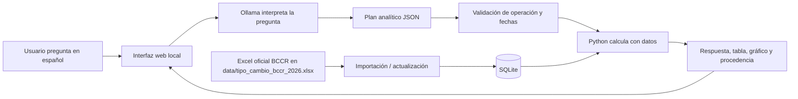

# Data Agent: tipo de cambio USD/CRC

Prototipo académico para investigar cómo un agente con **Ollama** interpreta preguntas en español y responde sobre los tipos de cambio oficiales de compra y venta del dólar en Costa Rica.

El proyecto viene con el Excel oficial 2026 descargado del BCCR. Ollama interpreta la pregunta y propone una operación acotada; Python calcula el resultado sobre los datos del Excel guardados en SQLite. El modelo no inventa cotizaciones ni ejecuta código o SQL libre.

## Diagrama



## Datos incluidos y actualización desde Excel

El archivo [`data/tipo_cambio_bccr_2026.xlsx`](data/tipo_cambio_bccr_2026.xlsx) contiene la serie oficial compartida del BCCR: 319 fechas entre el 1 de enero y el 15 de noviembre de 2026, con valores de compra y venta. No son datos sintéticos.

Al iniciar la aplicación, el Excel ubicado en `data/tipo_cambio_bccr_2026.xlsx` se vuelve a leer y reemplaza en SQLite la serie que importó previamente desde ese mismo archivo. **Para actualizar los datos del agente**, reemplaza ese Excel por la nueva descarga, conservando el mismo nombre y ubicación, y reinicia la aplicación. Así las siguientes preguntas se responden con la serie nueva.

También se puede cargar otro `.xlsx` o `.csv` desde la opción **Importa una serie** en la interfaz. El Excel debe incluir encabezados de fecha, compra y venta; el CSV debe usar `date,buy,sell`. Los datos quedan guardados localmente en `data/exchange_rates.sqlite3`.

## Instalación y ejecución en Windows

Requisitos: Python 3.10+, Ollama instalado y conexión a internet para descargar el modelo la primera vez. El proyecto no incluye el modelo de lenguaje.

### 1. Instalar Ollama y descargar el modelo

Si todavía no tienes Ollama, instálalo desde <https://ollama.com/download>. Después, abre PowerShell y descarga `qwen2.5:3b` (este paso se hace una sola vez):

```powershell
cmd.exe /c "ollama pull qwen2.5:3b"
if ($LASTEXITCODE -ne 0) { throw "Falló la descarga del modelo; revisa el mensaje de Ollama e inténtalo de nuevo." }
```

Se usa `cmd.exe` para evitar que algunas versiones de PowerShell muestren los caracteres animados de progreso de Ollama como errores. El texto `NativeCommandError` acompañado de esos caracteres no confirma por sí solo que la descarga haya fallado; comprueba el resultado con los siguientes pasos.

Verifica que Ollama está instalado y que el modelo terminó de descargarse:

```powershell
ollama --version
ollama list
```

En la salida de `ollama list` debe aparecer `qwen2.5:3b`. Si no aparece, vuelve a ejecutar `cmd.exe /c "ollama pull qwen2.5:3b"` y revisa que no termine con un mensaje `Error:`.

Para comprobar que el modelo responde a través del servicio local de Ollama, ejecuta:

```powershell
$body = @{ model = "qwen2.5:3b"; prompt = "Responde solo: Ollama listo"; stream = $false } | ConvertTo-Json
(Invoke-RestMethod -Uri "http://127.0.0.1:11434/api/generate" -Method Post -ContentType "application/json" -Body $body).response
```

Debe imprimir una respuesta del modelo. Si aparece un error de conexión, inicia Ollama desde otra ventana de PowerShell con `ollama serve` y repite la comprobación. La aplicación usa este mismo servicio y modelo para interpretar preguntas.

### 2. Instalar y arrancar el prototipo

En PowerShell, desde la carpeta del proyecto:

```powershell
python -m pip install -r requirements.txt
Copy-Item .env.example .env
python -m unittest discover -s tests -v
python app.py
```

Si las pruebas terminan con `OK`, las dependencias y las funciones principales del prototipo están verificadas. Para comprobar el agente completo, confirma primero que el modelo responde con el comando anterior y luego inicia `python app.py`. Abre <http://127.0.0.1:8765> y envía una pregunta de la sección de ejemplos; debe aparecer una respuesta con los datos del Excel y su fuente.

Ollama normalmente queda ejecutándose después de instalarlo. Si la prueba del modelo o la aplicación indica que no puede conectarse, abre **otra** ventana de PowerShell y ejecuta:

```powershell
ollama serve
```

Deja esa ventana abierta mientras usas el prototipo. El modelo configurado es `qwen2.5:3b`; puedes cambiar `OLLAMA_MODEL` en `.env` por otro modelo compatible que ya tengas descargado.

## Ejemplos de preguntas

- ¿Cuál fue el último tipo de cambio de venta?
- ¿Cuál fue el promedio de compra y venta en 2026?
- ¿En qué fecha estuvo más alto el tipo de cambio de venta?
- ¿Cómo cambió la venta entre enero y octubre?
- ¿Qué diferencia hubo entre compra y venta durante el año?

El agente está pensado para consultar fecha, valor, compra o venta; puede mostrar últimos datos, promedios, máximos, mínimos, variaciones y evolución. Si Ollama no está disponible, el prototipo informa el error en lugar de simular una respuesta.

## Actualización automática al iniciar

La aplicación reimporta el Excel principal al iniciar. La carga reemplaza las observaciones previamente importadas desde esa fuente, evitando conservar filas antiguas si el archivo actualizado ya no las incluye. También conserva la procedencia para que las respuestas indiquen de dónde salen los datos.

## Actualización en tiempo real (opcional)

El prototipo funciona con el archivo local y no necesita credenciales del BCCR. Si más adelante se desea obtener actualizaciones en tiempo real, se puede implementar la consulta al API SDDE del BCCR con autenticación Bearer. La credencial debe permanecer fuera del repositorio y no se necesita para ejecutar esta versión.

## Pruebas

```powershell
python -m unittest discover -s tests -v
```

## Archivos principales

```text
app.py                  Inicio de la aplicación y carga del Excel
data/tipo_cambio_bccr_2026.xlsx
                        Datos oficiales incluidos
data_agent/agent.py     Interpretación con Ollama y cálculos
data_agent/store.py     Lectura del Excel y almacenamiento SQLite
templates/index.html    Interfaz
static/                 Estilos y comportamiento del navegador
tests/                  Pruebas del agente, Excel y API web
```
